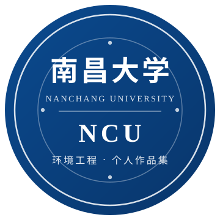

<div align="center">



<h1>人工智能通识与实践 · 个人作品集</h1>

<p><strong>南昌大学 · 环境工程</strong></p>

<p>
  
  
  
  
</p>

<p>一个零基础新生的 AI 实践成长记录：从"会提问"到"能做出可访问的作品"。</p>

</div>

---

## 一、我是谁

| 项目 | 内容 |
| --- | --- |
| 姓名 | 廖欣昊 |
| 学号 | 5807126068 |
| 专业 | 环境工程 |
| 学校 | 南昌大学 |
| 课程 | 人工智能通识与实践（16 周） |
| 起点 | 零编程基础，跨学科学习 |

**一句话目标**：把 AI 当成"随叫随到的工程师搭档"，让非计算机专业的人也能把想法做成能跑的东西。

---

## 二、全学期 16 周实验目录树

```text
ncu-ai-portfolio-5807126068/
├── README.md                    # 本文件：作品集总览
├── .gitignore                   # 不上传文件的"黑名单"
├── assets/                      # 图片、标识等静态资源
│   └── ncu-logo.svg             # 南昌大学标识（自绘矢量图）
├── labs/                        # 16 周实验主目录
│   ├── week01/                  # 第1周  课程导览与 AI 工具环境搭建
│   ├── week02/                  # 第2周  提示词工程基础
│   ├── week03/                  # 第3周  大模型问答能力评测
│   ├── week04/                  # 第4周  数据采集与清洗
│   ├── week05/                  # 第5周  表格处理与可视化
│   ├── week06/                  # 第6周  静态网页开发入门
│   ├── week07/                  # 第7周  调用 API 获取实时数据
│   ├── week08/                  # 第8周  中期项目：单城市实时查询
│   ├── week09/                  # 第9周  多城市网格与交互优化
│   ├── week10/                  # 第10周 信息采集与流程自动化
│   ├── week11/                  # 第11周 文本分析与观点提炼
│   ├── week12/                  # 第12周 文档自动化输出
│   ├── week13/                  # 第13周 AI 多媒体创作
│   ├── week14/                  # 第14周 工具调用与 MCP 实践
│   ├── week15/                  # 第15周 综合项目整合
│   └── week16/                  # 第16周 作品集整理与展示
├── 实验代码汇总/                # 周实验的代码成品归档
│   ├── 实验一_静态数据版/       # 静态页面
│   ├── 实验二_实时数据单城市版/ # 接入实时数据
│   ├── 实验三_实时数据网格版/   # 多城市网格展示
│   └── 三个版本功能对比.md      # 三个版本能力对比
├── 大学生必备AI工具使用指南/    # 第13周 AI 多媒体创作成果
├── index.html                   # 作品集总入口页
├── index-天气查询版.html        # 天气查询作品（静态版）
├── index-单城市查询版.html      # 天气查询作品（单城市实时版）
├── index-2024企业融资版.html    # 行业融资分析作品
├── 实验对比报告_三种问答场景.html # 第3周评测报告
├── AI行业实时融资分析报告.docx  # 第12周文档自动化成果
└── 人工智能课程学习心得.docx    # 学期复盘
```

> 每周目录内都有自己的 `README.md`，写明**学习目标、本周交付物、学习记录、自我评价**四块内容，便于逐周填写。

---

## 三、学期进度看板

| 周次 | 主题 | 关键能力 | 状态 |
| :--: | --- | --- | :--: |
| 01 | AI 工具环境搭建 | 工具链认知 | 待完成 |
| 02 | 提示词工程基础 | 精准表达需求 | 待完成 |
| 03 | 大模型问答评测 | 结果质量判断 | 待完成 |
| 04 | 数据采集与清洗 | 结构化数据 | 待完成 |
| 05 | 表格与可视化 | 用图说话 | 待完成 |
| 06 | 静态网页开发 | 前端三件套 | 待完成 |
| 07 | 调用 API | 实时数据接入 | 待完成 |
| 08 | 中期项目 | 闭环产品思维 | 待完成 |
| 09 | 多城市网格 | 交互与布局 | 待完成 |
| 10 | 信息采集自动化 | 流程化作业 | 待完成 |
| 11 | 文本分析 | 从数据到观点 | 待完成 |
| 12 | 文档自动化 | 规范交付物 | 待完成 |
| 13 | AI 多媒体创作 | 图文组合表达 | 待完成 |
| 14 | MCP 工具调用 | 让 AI 会"用工具" | 待完成 |
| 15 | 综合项目整合 | 系统集成 | 待完成 |
| 16 | 作品集与答辩 | 表达与复盘 | 待完成 |

---

## 四、代表性作品

| 作品 | 说明 | 入口 |
| --- | --- | --- |
| 天气查询（单城市实时版） | 调用天气接口，输入城市即可查看实时天气 | `index-单城市查询版.html` |
| 天气查询（多城市网格版） | 一次对比多个城市，适合出行决策 | `实验代码汇总/实验三_实时数据网格版/index.html` |
| 行业融资分析 | 采集 AI 行业融资信息并生成分析报告 | `index-2024企业融资版.html` |
| 三种问答场景对比 | 对同一问题做多模型 / 多问法对比评测 | `实验对比报告_三种问答场景.html` |

---

## 五、如何查看这些作品

1. **只看网页**：直接双击对应的 `.html` 文件，浏览器即可打开（部分页面需要联网调用接口）。
2. **克隆到本地**：

   ```bash
   git clone <本仓库地址>
   cd ncu-ai-portfolio-5807126068
   ```

3. 目录里的 `.docx` / `.pptx` 用 Office 或 WPS 打开即可。

> 提示：涉及第三方接口的页面，请自行在代码中填入自己的 API Key；仓库内不会保存任何密钥。

---

## 六、学习公约

- 每一周的成果都进仓库，**宁可粗糙，也要留下痕迹**。
- 不提交密钥、账号密码、他人隐私数据。
- 引用 AI 生成内容时，注明工具与提示词，保持学术诚实。
- 每次提交写清楚"这次改了什么"，方便回看自己的成长轨迹。

---

<div align="center">

**南昌大学 · 环境工程 · 廖欣昊 · 5807126068**

<sub>Made with curiosity, guided by AI.</sub>

</div>
